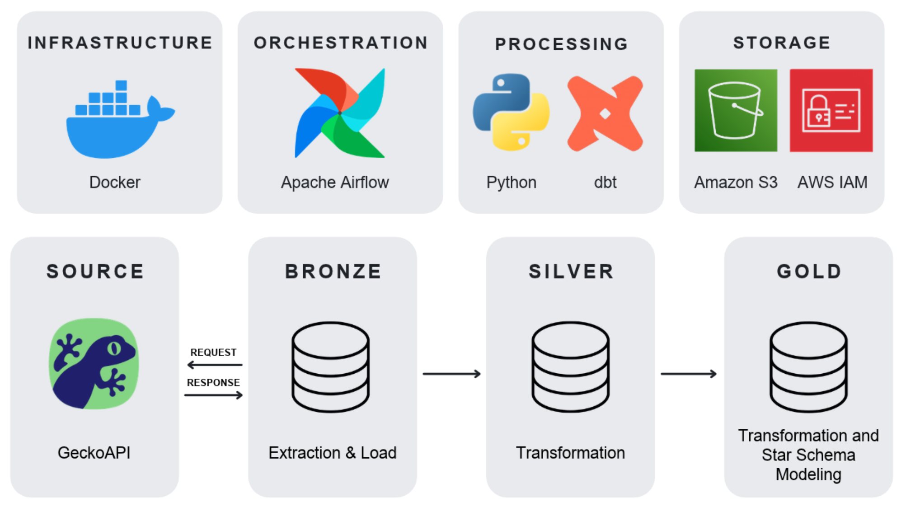

# Pipeline de ETL e Modelagem Dimensional: Anúncios de iPhone 18 Pro Max no Mercado Livre

## 1. Sobre o Projeto

Este projeto de engenharia de dados foi desenvolvido para o meu portfólio e demonstra um pipeline end-to-end de ETL e modelagem dimensional. Ele simula um trabalho para uma empresa fictícia, a ValueMetrics, que precisa de dados acerca de anúncios de iPhone 18 Pro Max no Mercado Livre para que seus lojistas comparem seus preços de celulares e telefones com os atuais da concorrência.

Ele segue a arquitetura medalhão, com os dados armazenados no Amazon S3. Na camada bronze, um script em Python extrai todas as páginas da listagem pela GeckoAPI e salva o JSON bruto; na silver, outro script em Python transforma os dados e grava o resultado em Parquet; na gold, o dbt, com DuckDB, lê a silver direto do S3, termina a transformação dos dados e modela os dados em dimensões e em uma tabela fato de anúncios.

A orquestração é feita pelo Apache Airflow em Docker: basta subir os containers para que as três camadas rodem em sequência, de forma agendada e automatizada.

### 1.1. Pipeline



### 1.2. Stack Tecnológica

#### Ferramentas
- **Python 3.12**: Linguagem para ETL.
- **GeckoAPI**: API para extração dos dados do Mercado Livre.
- **Amazon S3**: Serviço de nuvem para armazenar os dados (camadas bronze, silver e gold).
- **AWS IAM**: Serviço de nuvem para criar o user e policy necessários para o script Python interagir com o bucket do Amazon S3.
- **dbt v1**: Ferramenta para a finalização da transformação e a modelagem de esquema estrela.
- **DuckDB**: Banco analítico utilizado pelo dbt para ler o silver e gravar a camada gold no S3.
- **Apache Airflow**: Orquestração do pipeline.
- **Docker**: Ferramenta para isolar, padronizar e rodar toda a infraestrutura do Airflow e suas dependências.
- **VS Code**: Ferramenta utilizada para desenvolvimento do projeto.

#### Bibliotecas Python
- **requests**: Requisições HTTP para a GeckoAPI.
- **pandas**: Manipulação e transformação de dados.
- **boto3**: Integração com o Amazon S3 (camadas bronze e silver).
- **pyarrow**: Escrita de arquivos Parquet.
- **python-dotenv**: Gerenciamento de variáveis de ambiente.
- **dbt-core**: Framework de transformação de dados em SQL.
- **dbt-duckdb**: Adaptador do dbt para o DuckDB.
- **ipynbname**: Identificação do notebook Jupyter em execução.

#### Ferramentas de Desenvolvimento
- **ipykernel**: Kernel Jupyter para execução do notebook.
- **ruff**: Linter e formatador de código.

#### Pacotes dbt
- **dbt_utils**: Geração de chaves substitutas (`generate_surrogate_key`) nas tabelas dimensão da camada gold.

### 1.3. Etapas do Pipeline (ETL e Modelagem Dimensional)

#### 1.3.1. Extração e Carga - Python

**Arquivo**: [source/extract_and_load_data.py](source/extract_and_load_data.py)

**Extração:**
- Consulta a GeckoAPI pedindo a listagem de anúncios de "iphone-18-pro-max" no Mercado Livre, a partir da página 1.
- Calcula o total de páginas (totalResults / resultsPerPage, arredondando para cima) e busca as demais, juntando as respostas em uma lista.

**Carga:**
- Converte os dados em JSON (UTF-8, indentado e mantendo os acentos) e salva no S3, em bronze/mercadolivre/iphone-18-pro-max/<data-hora>/bronze_data.json.
- Registra a data/hora da extração (fuso America/Sao_Paulo) no .env como EXTRACT_DATETIME, para a etapa seguinte encontrar o arquivo.

**Blindagens:**
- Valida API_KEY e credenciais da AWS antes de qualquer chamada, falhando cedo com TypeError e log.
- Usa timeout (10s para conectar e 120s para responder) para o pipeline não ficar travado esperando a API.
- Trata erros HTTP da GeckoAPI com raise_for_status, como chave inválida (401), créditos insuficientes (402), limite de requisições (429) e falhas de servidor (5xx).
- Trata o notFound separadamente, porque a API responde 200 com `data` nula quando a página não existe e o raise_for_status não pega esse caso.
- Captura falhas de conexão, timeout e erros do próprio código com try/except Exception.
- Todo erro é registrado em logs/extract_and_load_data.log, com o número da página, e relançado com raise, então o pipeline nunca segue com dados incompletos.

#### 1.3.2. Transformação - Python

**Arquivo**: [source/transform_data.py](source/transform_data.py)

**Leitura:**
- Lê do S3 o bronze_data.json da extração (EXTRACT_DATETIME) e transforma o JSON em DataFrame.

**Transformações:**
- Normalização de colunas: explode a coluna data.items, para ficar um anúncio por linha, e concatena as colunas normalizadas ao DataFrame.
- Remoção de colunas: descarta as desnecessárias (requestId, executionId, data.source, data.type, data.url, data.requestUrl, data.query, data.totalResults, data.primaryResults, data.page, data.resultsPerPage, data.offset, data.nextPage, data.nextPageUrl, data.items e aggregateRating).
- Renomeação: padroniza todas as colunas em snake_case (por exemplo, sellerName vira seller_name e aggregateRating.rating vira rating).
- Conversão de tipos: define o tipo de todas as colunas (string, Float64 e boolean).
- Normalização de formatos: extracted_at vira AAAA-MM-DDTHH-MM-SS e, em name, remove espaços extras e deixa GB e TB em maiúsculas (256 gb vira 256GB).
- Tratamento de duplicatas: remove dados repetidos pela coluna de identificação url e a coloca no início do DataFrame.

**Carga:**
- Salva o resultado em Parquet (pyarrow, sem índice) no S3, em silver/mercadolivre/iphone-18-pro-max/<data-hora>/silver_data.parquet.
- Registra a data/hora da transformação (fuso America/Sao_Paulo) no .env como TRANSFORM_DATETIME, para o dbt encontrar o arquivo.

**Blindagens:**
- Valida o EXTRACT_DATETIME antes de qualquer leitura, falhando cedo com TypeError e log, para não procurar um arquivo inexistente no S3.
- A leitura do bronze fica dentro de um try/except, que registra no log qualquer erro ocorrido durante a leitura e o relança com raise.
- O envio do silver também fica dentro de um try/except, que registra no log qualquer erro ocorrido durante a conversão para Parquet e o upload e o relança com raise.
- - Os erros ficam registrados em logs/transform_data.log e, por serem relançados, interrompem o pipeline em vez de seguir com dados incompletos.
- Cada etapa bem-sucedida de leitura e envio também fica registrada no log.

#### 1.3.3. Transformação e Modelagem Dimensional - dbt

**Processo de Design Dimensional em Quatro Etapas:**

- Processo de negócio: O processo de negócio da GeckoAPI utilizado no projeto é prover dados públicos estruturados de anúncios de iPhones 18 Pro Max do Mercado Livre
- Declarar a granularidade: Cada linha da tabela fct_ads representa um anúncio individual (identificado pela sua url única) de um iPhone 18 Pro Max no Mercado Livre, no momento da extração
- Identificar as dimensões: currency, seller, product e highligh
- Identificar os fatos: price, rating e review_count

**Arquivos**: [models](dbt_/models/)

**Leitura (models/sources.yml):**
- O sources.yml aponta para o silver_data.parquet gerado pelo transform_data.py no S3, da data/hora da transformação (TRANSFORM_DATETIME).

**Pasta staging (continuação das 6 transformações do transform_data.py):**
- Imputação de nulos e vazios: no stg_ads, todo texto nulo ou vazio vira "Sem informação" (ou "Sem destaque" no highlight).
- Padronização dos booleanos: no stg_ads, is_best_seller e is_power_seller viram "Verdadeiro" ou "Falso" (ou "Sem informação" quando nulos).
- Tratamento de outliers das métricas: no stg_ads, price negativo, rating fora de 1 a 5 e review_count negativo viram nulo. Com isso o stg_ads fica com uma linha por anúncio e serve de base para a tabela fato.
- Separação e deduplicação das dimensões: o stg_currency, o stg_highlight, o stg_product e o stg_seller aplicam o mesmo preenchimento de nulos e vazios descrito acima (e a padronização dos booleanos, no caso do stg_seller), cada um com as colunas da sua dimensão, e mantêm só uma linha para cada combinação repetida (ROW_NUMBER).
- Os modelos da pasta staging são materializados como view, ou seja, não geram arquivo no S3.

**Pasta marts (modelagem dimensional em esquema estrela):**
- Chaves substitutas: o dim_currency, o dim_highlight, o dim_product e o dim_seller recebem os dados do staging correspondente e ganham uma chave gerada pelo dbt_utils (currency_key, highlight_key, product_key e seller_key).
- Montagem da fato: o fct_ads parte do stg_ads, com uma linha por anúncio, e liga cada anúncio às quatro dimensões (LEFT JOIN) pelos mesmos campos usados nas chaves.
- A fato guarda as chaves das dimensões, as métricas price, rating e review_count, além de url e extracted_at.
- Carga: as dimensões e a fato da pasta marts são salvas em Parquet no S3, em gold/mercadolivre/iphone-18-pro-max/.

**Blindagens:**
- Na pasta staging, o mesmo preenchimento de nulos e vazios é aplicado no stg_ads e nas dimensões, então os campos de ligação sempre têm valor e os joins da fato, feitos na pasta marts, encontram a chave correspondente.
- Na pasta staging, as dimensões são deduplicadas antes de ganhar a chave, para cada chave (gerada na pasta marts) identificar uma única linha e a fato não multiplicar anúncios.
- Na pasta marts, os joins da fato são LEFT JOIN, então nenhum anúncio é descartado mesmo que falte correspondência em alguma dimensão.
- Na pasta staging, os outliers das métricas viram nulo em vez de receber um valor inventado, como recomenda Kimball para métricas desconhecidas na fato.

### 1.4. Decisões arquiteturais

- **Não ter Slowly Changing Dimension Type 2**: O plano inicial do projeto era utilizar dbt snapshots para ter SCD2 nas dimensões para o caso de ser feita mais de uma extração de dados. Cheguei a implementar, porém diferente do que aparece na documentação da GeckoAPI, colunas que serviriam como chaves naturais vieram com valores nulos, portanto se tornou insustentável escolher uma chave natural (uma ou mais colunas) e conseguir versionar sem saber o que poderia vir nulo em diferentes extrações.
- Outliers e nulos/vazios: A decisão de transformar na camada gold se deu para simular que a camada silver poderia ser utilizada por outras áreas, como Ciência de Dados, que lida com tais problemas de outras formas.

## 2. Rodando o Projeto

### 2.1. Instalar o Docker para seu Sistema Operacional

- [Linux](https://docs.docker.com/engine/install/)
- [Windows](https://docs.docker.com/desktop/setup/install/windows-install/)
- [Mac](https://docs.docker.com/desktop/setup/install/mac-install/)

No Windows e no macOS, abra o Docker Desktop antes de rodar os comandos.

Para conferir se deu certo:
```bash
docker compose version
```

### 2.2. Obter API Key da GeckoAPI

- Acesse a [GeckoAPI](https://geckoapi.com.br/) e obtenha sua API Key.

### 2.3. Criar Bucket no Amazon S3 e user e policy AWS IAM

- Siga o passo a passo da publicação [Uploading Files to AWS S3 using Python and Boto3](https://medium.com/@financial_python/uploading-files-to-aws-s3-using-python-and-boto3-622efbe1af5c#id_token=eyJhbGciOiJSUzI1NiIsImtpZCI6Ijk0M2EzYTVkN2Q5MTk2MjVhNDU0ZTQ4OWI3NWMyOWFkYWI1N2FjYmEiLCJ0eXAiOiJKV1QifQ.eyJpc3MiOiJodHRwczovL2FjY291bnRzLmdvb2dsZS5jb20iLCJhenAiOiIyMTYyOTYwMzU4MzQtazFrNnFlMDYwczJ0cDJhMmphbTRsamRjbXMwMHN0dGcuYXBwcy5nb29nbGV1c2VyY29udGVudC5jb20iLCJhdWQiOiIyMTYyOTYwMzU4MzQtazFrNnFlMDYwczJ0cDJhMmphbTRsamRjbXMwMHN0dGcuYXBwcy5nb29nbGV1c2VyY29udGVudC5jb20iLCJzdWIiOiIxMDY3MjYyNTQ0MDU3NzI2MzYzMjgiLCJlbWFpbCI6Im1hbGJhdjEwMEBnbWFpbC5jb20iLCJlbWFpbF92ZXJpZmllZCI6dHJ1ZSwibm9uY2UiOiJub3RfcHJvdmlkZWQiLCJuYmYiOjE3OTIwNjkyMTEsIm5hbWUiOiJNQUxCQSBWSU5JQ0lVUyBMT1BFUyBTQU5UT1MiLCJwaWN0dXJlIjoiaHR0cHM6Ly9saDMuZ29vZ2xldXNlcmNvbnRlbnQuY29tL2EvQUNnOG9jTFVNbmZrVHJaQTdybzhpWjh0NmVJOHA5dGZHX3M5b0trTVRNNDNHQ3kwUWRpQTEyb0M9czk2LWMiLCJnaXZlbl9uYW1lIjoiTUFMQkEgVklOSUNJVVMiLCJmYW1pbHlfbmFtZSI6IkxPUEVTIFNBTlRPUyIsImlhdCI6MTc5MjA2OTUxMSwiZXhwIjoxNzkyMDczMTExLCJqdGkiOiJjMTE2MWUxZjBmOTUyM2JmNWM3YjUyNjdkNTYxNGY1MjQwZDg5ZmEzIn0.d2ih0SiiiMYhAVyvc-Dg3CYrFMJoHB6QBN7a_wpfJFf-TuWnA_5ageF4nhy5t7QO7nDoLTqZtsIsBh5Rv6HvRY8zME7tCusOtwHLJjj8r2yLkBFFmh2J9cD-3eUOkCevNDRyUNLNf6p2xOCDo3q7MSNfcJaAcpv68OOtuHDqNLb8Kl_laOxxzo9NwhE__wUaULdRIAY-I63UR33o0J-pQ1uth7wCbVYBYynb_fUgzrnSDk-gJajvyagjdnIY_fRnKTDYnW0BanQYOh4Jddp7laJPiiO6bmHBMH4A3xWPgCC38d-u-4W3QD9nrVo7AWMwePUyRVDVQ_NbrVLusmocZw) 

### 2.4. Clonar o Repositório

```bash
git clone https://github.com/mlbvncs/mercadolivre-etl-dbt
cd mercadolivre-etl-dbt
```

### 2.5. Criar Arquivo .env

Crie na raiz do projeto um arquivo `.env` e preencha (substituindo pelos seus dados):

```bash
API_KEY=''
S3_BUCKET_NAME=''
AWS_ACCESS_KEY_ID=''
AWS_SECRET_ACCESS_KEY=''
_PIP_ADDITIONAL_REQUIREMENTS=dbt-core dbt-duckdb
```

O Airflow roda dentro de um container e escreve nas pastas
`logs/`, `dags/`, `plugins/` e `config/` do seu PC. Rode o comando abaixo para o container
usar o mesmo número de usuário (UID) que o seu, para ele ter permissão de escrita
nessas pastas. Sem isso, pode dar `Permission denied`.

```bash
echo "AIRFLOW_UID=$(id -u)" >> .env
```

### 2.6. Utilizando a Orquestração do Apache Airflow

Para criar e iniciar o container do Apache Airflow, rode o comando:

```bash
docker compose up -d
```

Para rodar o pipeline de orquestração:
- Acesse: [Apache Airflow](localhost:8080). 
- Preencha os campos Username e Password com `airflow`.
- Pesquise por `geckoapi_pipeline_dag`, escolha e acione.

Após finalizar, para parar e remover completamente os contêineres e redes criados pelo projeto, rode:

```bash
docker compose down
```

## 3. Referências

- [pipeline_etl_weather_data_tutorial_youtube](https://github.com/vbluuiza/pipeline_etl_weather_data_tutorial_youtube)
- [ETL e Ingestão de Dados](https://ensinadev.com.br/trilhas/c48acd54-e3b0-4e50-b7db-124080064d72)
- [The DataWarehouseToolkit, Third Edition](https://darinadata.ir/wp-content/uploads/2025/02/Wiley_The_Data_Warehouse_Toolkit_The_Definitive_Guide_to_Dimensional.pdf)
- [Design Tip #128 Selecting Default Values for Nulls](https://www.kimballgroup.com/2010/10/design-tip-128-selecting-default-values-for-nulls/)

## 4. Contato

- [Gmail](mailto:malbav100@gmail.com)
- [Curriculum](https://docs.google.com/document/d/104XNS8vWekJmQSktHs24O5OCgC1jYzGn/edit?usp=sharing&ouid=106726254405772636328&rtpof=true&sd=true)
- [LinkedIn](https://www.linkedin.com/in/malbavinicius)
- [Medium](https://medium.com/@malbav100)

## 5. Autoria

Desenvolvido por [@mlbvncs](https://github.com/mlbvncs)
